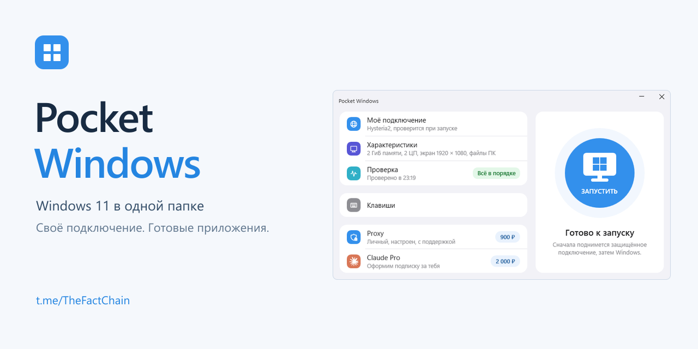
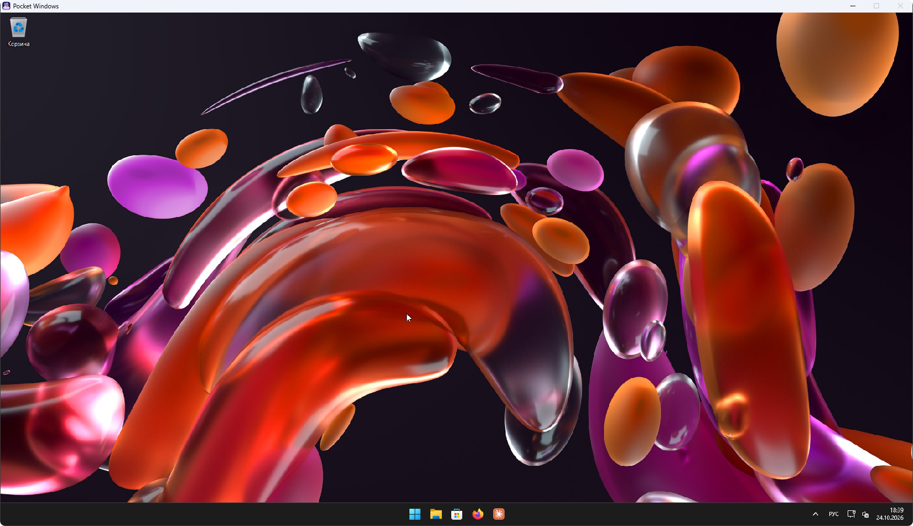
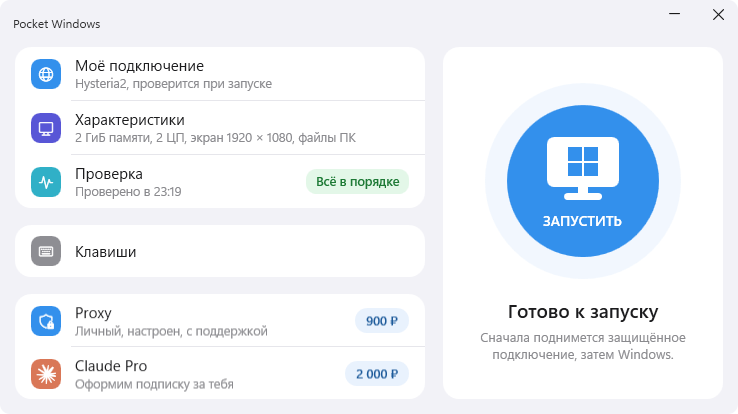
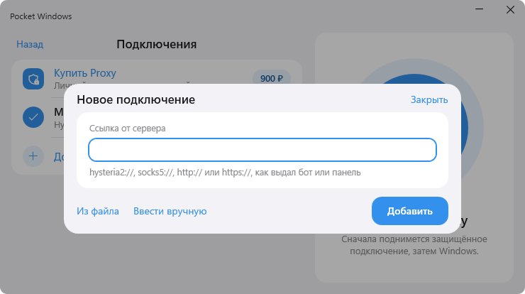
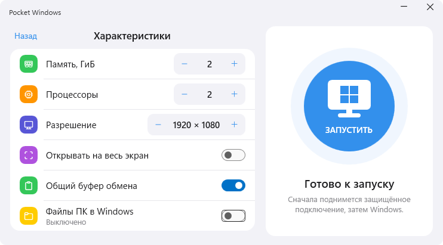
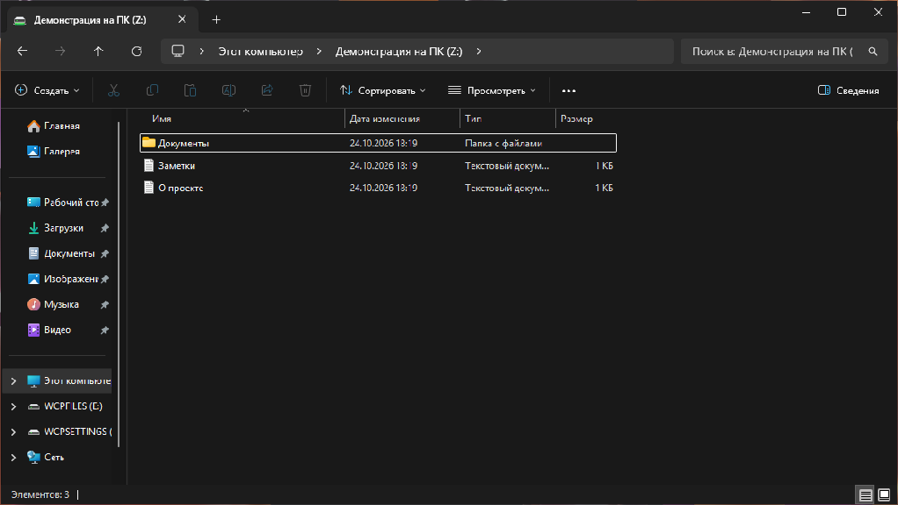
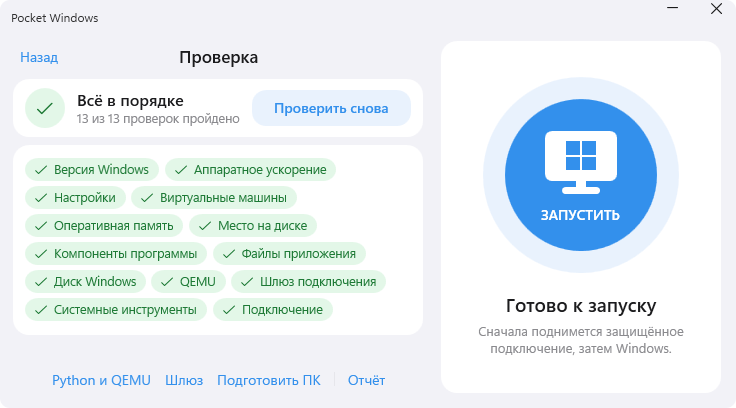
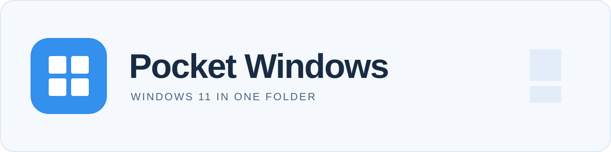

[Русский](README.md) | [English](README.en.md)

# Pocket Windows

**Windows 11 в одной папке — с твоим подключением и подготовленными приложениями.**

<p align="center">
  <a href="https://t.me/TheFactChain"></a>
  <a href="https://drive.google.com/drive/folders/1OnAncsF3BK5Mo6Vc245Z0D7sW1iBxKHD"></a>
</p>
<p align="center">
  <a href="#первый-запуск"></a>
  <a href="docs/updating.md"></a>
  <a href="https://www.youtube.com/watch?v=KAFEjYQKF1E"></a>
  <a href="#%D0%B5%D1%81%D0%BB%D0%B8-%D1%87%D1%82%D0%BE-%D1%82%D0%BE-%D0%BD%D0%B5-%D1%80%D0%B0%D0%B1%D0%BE%D1%82%D0%B0%D0%B5%D1%82"></a>
</p>

Переносимая Windows для доступа к заблокированным сервисам через готовый прокси. В одной папке находятся Windows 11, панель запуска и отдельное сетевое окружение. Распакуй комплект, добавь подключение и открой рабочий стол с подготовленными Claude Desktop и Firefox.

<p align="center"><br />
<sub>На изображении — интерфейс версии 2026.10.24.13 и цены на тот момент. Учётные записи и подписки в комплект не входят.</sub></p>

<p align="center"><a href="https://www.youtube.com/watch?v=KAFEjYQKF1E"></a><br />
<a href="https://www.youtube.com/watch?v=KAFEjYQKF1E"><strong>Смотреть видеообзор на YouTube</strong></a></p>

## С чего начать

**Первый запуск:** [скачать полный комплект 2026.10.25.7](https://drive.google.com/drive/folders/1OnAncsF3BK5Mo6Vc245Z0D7sW1iBxKHD).

**Уже есть Pocket Windows:** [последнее обновление для существующей копии](https://github.com/nekontritce11123-lab/pocket-windows/releases/latest).

> **Полный комплект и обновление — разные загрузки.** На Google Диске лежит полный комплект **2026.10.25.7**, около **17,0 ГБ** (15,8 ГиБ). Обновлятор уже входит в него: после распаковки открой «Обновления» и установи актуальную версию. На GitHub публикуются обновления **без диска Windows**; сами по себе они не запускаются.

| Твоя ситуация | Что делать |
| --- | --- |
| Pocket Windows ещё нет | Скачай **полный комплект** на Google Диске и следуй разделу [«Первый запуск»](#первый-запуск). |
| Уже есть версия 2026.10.25.3 или новее | Штатно выключи гостевую Windows, открой **«Обновления»** в лаунчере и нажми **«Проверить»**, затем **«Обновить»**. |
| Есть старая версия 2026.10.24.13 | Используй [отдельную инструкцию перехода](docs/updating.md#версия-2026102413), затем обновляйся из лаунчера. |

**В руководстве:** [скачивание и SHA256](#скачать) | [требования к компьютеру](#что-нужно-компьютеру) | [известные ограничения](#известные-ограничения) | [документация](#документация-и-исходники)

Интерфейс программы пока на русском. Инструкция доступна на [английском](README.en.md). Снимки ниже сделаны в версии 2026.10.24.13; новые функции описаны отдельно.

## Возможности



*Отдельный рабочий стол Windows для браузера и приложений, которым нужно выбранное подключение.*

### Отдельная Windows для нужных сервисов

Открывай сайты в Firefox и работай с приложениями внутри Pocket Windows. Их трафик проходит через выбранное подключение. Для этого не нужно перенастраивать VPN основной Windows: отдельная среда использует собственный шлюз.

Система и установленные в ней программы сохраняются в папке комплекта между запусками. Её можно перенести на другой совместимый ПК после штатного выключения Windows. Для сохранённых паролей подключения на новом ПК потребуется повторный ввод.

Claude Desktop и Firefox уже подготовлены. Учётные записи, подписки и доступность сервисов зависят от самих сервисов и твоего подключения; комплект их не предоставляет.

### Запуск из одной панели

Главная страница показывает состояние Windows и выбранное подключение. Отсюда можно запустить рабочий стол, вернуться в уже работающую Windows или выключить её. Устанавливать отдельные QEMU, Python или Linux для готового комплекта не нужно.



*Панель запуска и управления сеансом.*

После запуска панель сворачивается в трей. Закрытие панели не выключает работающую Windows. Для завершения сеанса используй «Выключить Windows» в панели или меню значка в трее и дождись остановки перед переносом папки.

В версии **2026.10.25.7** в трее также есть «Выключить Windows и выйти»: команда дожидается подтверждённой остановки Windows и шлюза, затем закрывает панель. После неподтверждённого выключения может появиться отдельная кнопка «Принудительно выключить». Она требует подтверждения: несохранённые данные могут потеряться, а диск гостевой Windows — повредиться.

### Сеть через готовое подключение

Добавь ссылку на подключение или заполни его параметры в панели. Нужен уже работающий сервер или прокси с действующими данными доступа. Pocket Windows не разворачивает сервер на пустом VPS.

Поддерживаются **Hysteria2 для TCP и UDP**, а также **SOCKS5, HTTP и HTTPS CONNECT для TCP**. Внешнее подключение работает через **IPv4**. Возможность открыть конкретный сервис зависит от сервера, его расположения и правил сервиса.



*Добавление подключения из готовой ссылки или по параметрам сервера.*

Если соединение обрывается, прямой выход Windows в интернет не открывается. Сеть остаётся закрытой до восстановления подключения. Сохранение или проверка другого профиля не переключает уже работающий сеанс: изменения применяются при следующем запуске Windows.

### Память, экран и буфер обмена

В характеристиках можно выбрать объём памяти Windows, число процессоров и разрешение экрана. Настройки ресурсов и окна применяются при следующем запуске.



*Настройка ресурсов и поведения рабочего окна.*

Работай в окне или переключай полный экран сочетанием `Ctrl+Alt+F`. Чтобы освободить мышь, используй `Ctrl+Alt+G`. Полный экран сохраняет пропорции выбранного разрешения, поэтому при несовпадении с пропорциями монитора возможны поля.

Общий буфер передаёт **текст** в обе стороны между основной и гостевой Windows. Его можно отключить в настройках перед следующим запуском. Копирование изображений не поддерживается.

В актуальном обновлении реализована передача файлов через `Ctrl+C` / `Ctrl+V`, но её работа в Проводнике в обе стороны ещё не прошла полную живую приёмку. В полном комплекте 25.7 до обновления буфер передаёт только текст. Для обмена файлами используй [доступ к выбранной папке ПК](#доступ-к-файлам-пк-по-твоему-выбору).

### Доступ к файлам ПК по твоему выбору

Общий доступ выключен по умолчанию. Можно открыть только выбранные папки или все доступные диски ПК. Выбор применяется при следующем запуске Windows; при первом включении гостевой помощник может запросить права администратора внутри неё для настройки файлового подключения.



*Выбранная папка ПК с демонстрационными файлами открыта внутри Pocket Windows.*

Это доступ к настоящим файлам ПК. Изменение или удаление общего файла внутри Pocket Windows изменяет или удаляет оригинал. Для первых запусков удобнее открыть отдельную папку с нужными файлами.

## Скачать

### Полный комплект для первого запуска

Открой [папку Pocket Windows на Google Диске](https://drive.google.com/drive/folders/1OnAncsF3BK5Mo6Vc245Z0D7sW1iBxKHD) и скачай **`Pocket-Windows-2026.10.25.7.zip`**. Размер — **16 973 575 467 байт**. В архиве уже есть Windows, лаунчер, обновлятор и среда запуска; отдельный установщик не нужен.

Файл доступен без входа в аккаунт. Google Диск может попросить подтвердить скачивание, поскольку архив слишком большой для его антивирусной проверки. После распаковки обнови приложение через лаунчер — повторно скачивать весь диск Windows не потребуется.

SHA256:

```text
e59cacf90eef062a7deb43ea25afce17d131f0ec7bda55b7773dc39d70f9c101
```

### Обновление существующей копии

Актуальный опубликованный выпуск — **[2026.10.29.3](https://github.com/nekontritce11123-lab/pocket-windows/releases/tag/v2026.10.29.3)**: микрофон, звук, настройки сна и накопленные исправления. Полный пакет приложения `Pocket-Windows-2026.10.29.3-app.zip` занимает **909 595 516 байт** (около 910 МБ). Диск Windows в него не входит. Обычно скачивать его вручную не нужно: используй **«Обновления»** в лаунчере и [инструкцию для своей версии](docs/updating.md).

Новый обновлятор скачивает изменившиеся проверяемые части и продолжает прерванную загрузку. Объём зависит от установленной версии и сохранённого кэша; первая загрузка может быть большой.

| Файл в Assets на GitHub | Для чего он нужен |
| --- | --- |
| `Pocket-Windows-<версия>-app.zip` | Полный пакет **обновления приложения**, без Windows. Не распаковывай `app` вручную поверх установки. |
| `-chunks.zip`, `-update.json`, `-update-v2.json`, `-updater.zip` | Служебные файлы обновлятора. Вручную выбирать и запускать их не нужно. `-updater.zip` не является установщиком для первого запуска. |
| `*.sha256` | Контрольная сумма соседнего файла. |
| **Source code (zip / tar.gz)** | Исходники для разработчиков. Это не готовая программа. |

<details>
<summary>SHA256 пакета приложения 2026.10.29.3</summary>

```text
21d08f305d94807ce4df0062da61f29c6633339a53cd3721372ecd6a0504c874
```

</details>

### Проверка скачанного ZIP

В PowerShell выполни команду, подставив путь к скачанному файлу:

```powershell
Get-FileHash -LiteralPath 'C:\Users\YOUR_NAME\Downloads\Pocket-Windows-2026.10.25.7.zip' -Algorithm SHA256
```

Сравни значение `Hash` со значением **для той же версии и того же имени файла** выше или в соседнем `.sha256`. Если значения различаются, не используй архив и скачай его повторно. SHA256 проверяет целостность относительно опубликованной суммы; это не цифровая подпись издателя.

## Первый запуск

1. **Скачай полный комплект и проверь SHA256.** Используй [инструкцию загрузки](#скачать). Архив обновления и Source code для первого запуска не подходят.
2. **Распакуй архив целиком.** Используй Проводник Windows и новую папку, доступную для записи. Не запускай `Launcher.exe` из окна архива и не отделяй его от остальных файлов.
3. **Обнови приложение.** Открой `Launcher.exe`, затем «Обновления». Нажми «Проверить», затем «Обновить» и дождись завершения. Эта функция уже есть в полном комплекте 25.7; Windows для обновления запускать не нужно.
4. **Проверь компьютер.** Открой раздел «Проверка». Если платформа гипервизора выключена, используй «Подготовить ПК», подтверди запрос администратора и перезагрузи компьютер, если потребуется.
5. **Добавь подключение.** В разделе «Подключения» укажи готовый Hysteria2, SOCKS5, HTTP или HTTPS-прокси и проверь его. Данные сервера нужно получить у своего провайдера подключения.
6. **Запусти Windows.** Вернись на главную и нажми кнопку запуска. Сначала подготавливается сеть, затем открывается рабочий стол. Войди в свои приложения и сервисы.

Сохраняй работу внутри Windows и завершай сеанс командой **«Выключить Windows»**. Дождись остановки перед переносом или резервным копированием папки. Чтобы снова открыть панель, нажми значок Pocket Windows в трее рядом с часами. Не извлекай флешку или внешний диск во время работы.

## Что нужно компьютеру



*Панель проверяет готовность компьютера и показывает, что нужно исправить перед запуском.*

| Ресурс | Требование |
| --- | --- |
| Система | Windows 11 x64 и .NET Framework 4.8 |
| Виртуализация | Включена в BIOS/UEFI, доступна Windows Hypervisor Platform |
| Свободная RAM | **6 ГиБ** при стандартных настройках: 4 ГиБ для Windows, 1 ГиБ для шлюза и 1 ГиБ запаса |
| Место после распаковки | Около **18,1 ГБ** плюс **не менее 2 ГиБ свободно** для запуска |
| Загрузка и распаковка | Рекомендуется около **40 ГБ свободно**, если сохраняешь скачанный ZIP |
| Сеть | Интернет и рабочий сервер или прокси поддерживаемого типа |

При изменении выделенной памяти требование пересчитывается. Место на диске растёт по мере добавления данных в Windows.

## Частые вопросы

### Нужно ли устанавливать Windows или Linux?

Для готового комплекта достаточно распаковки. Подготовленная Windows и скрытый сетевой шлюз уже входят в него. На самом ПК должны быть доступны перечисленные выше компоненты виртуализации.

### Можно ли перенести папку на другой ПК?

Да, после штатного выключения Windows. Сам архив и диск Windows не зашифрованы. Пароли профилей защищаются Windows DPAPI для текущего пользователя основной системы, поэтому на другом ПК или под другой учётной записью их нужно ввести заново.

### Почему после изменения подключения сеть осталась прежней?

Профиль, параметры ресурсов и настройки общего доступа применяются к следующему сеансу. Выключи Windows через панель и запусти снова. Проверка профиля подтверждает ответ сервера, но сама по себе не меняет подключение работающей Windows.

### Что делает восстановление?

Раздел «Проверка» помогает восстановить Python и QEMU из локального архива, заменить шлюз или восстановить прерванный сеанс. Эти действия отделены от диска Windows и сохранённых подключений. Повреждённый диск Windows они не исправляют: для его восстановления нужна исправная резервная копия.

### Нужно ли снова скачивать весь образ ради обновления приложения?

Нет: полный комплект 25.7 уже умеет обновляться из лаунчера. Обновляется приложение, диск Windows и данные сохраняются. См. [инструкцию обновления](docs/updating.md), включая отдельный переход со старой 24.13. Не заменяй диск Windows файлом из другого полного комплекта.

### Где сообщить о проблеме?

Создай обращение в [GitHub Issues](https://github.com/nekontritce11123-lab/pocket-windows/issues/new). Можно писать на русском или английском. Укажи версию Pocket Windows, версию основной Windows, действие, ожидаемый результат и текст ошибки. Для ошибки обновления добавь исходную и целевую версии. Перед публикацией убери из снимков и журналов пароли, ссылки на подключения и личные данные. [Telegram](https://t.me/TheFactChain) используется для новостей проекта.

## Если что-то не работает

| Ситуация | Что проверить |
| --- | --- |
| Нет `Launcher.exe` или не хватает компонентов | Убедись, что скачан полный комплект и ZIP распакован целиком. Папка должна быть доступна для записи. |
| Не готова виртуализация | Открой «Проверка». Включи виртуализацию в BIOS/UEFI и выполни предложенную подготовку ПК; после неё может потребоваться перезагрузка. |
| Не хватает памяти или места | Закрой лишние программы или уменьши память гостевой Windows в «Характеристиках». Сверь требования выше; учитывай рост диска и место для обновления. |
| Внутри Windows нет интернета | Проверь готовое подключение в панели. При его обрыве прямой интернет намеренно не открывается. После изменения профиля выключи и снова запусти гостевую Windows. |
| Не видна папка ПК | Выбери отдельную тестовую папку в настройках доступа и перезапусти гостевую Windows. Изменения в общей папке затрагивают оригиналы. |
| Обновление прервано | Сохрани текст ошибки и файлы восстановления, следуй [инструкции обновления](docs/updating.md). Не удаляй `state` и не копируй `app` вручную. |

## Известные ограничения

- Полный комплект на Google Диске имеет версию 25.7; свежие исправления устанавливаются через «Обновления» в лаунчере.
- Передача файлов через буфер, сообщения о его сбоях, сохранение дополнительных потоков NTFS и восстановление статуса папок после сбоя ещё требуют завершения живых проверок. Служебные диски `WCPSETTINGS` / `WCPFILES` могут быть видны в Проводнике.
- Внешний интернет — IPv4; UDP работает через Hysteria2. Доступ к файлам с несколькими жёсткими ссылками и точкам перенаправления ограничен защитой папок ПК.
- В 29.3 добавлены звук и микрофон, но реальная запись, воспроизведение и поведение экрана после длительного бездействия ещё ожидают проверки владельцем. Выбери стандартные звуковые устройства до запуска; для записи нужны разрешения микрофона в основной и гостевой Windows.
- Полная приёмка на другом ПК, двух мониторах и в полном экране не завершена. Есть зарегистрированный нестабильный отказ локального файлового сервера `AccessDenied`.

Подробности проверок и ограничений каждого выпуска находятся в его [заметках на GitHub](https://github.com/nekontritce11123-lab/pocket-windows/releases/latest).

## Документация и исходники

[Репозиторий Pocket Windows](https://github.com/nekontritce11123-lab/pocket-windows) содержит код панели, служебные сценарии, тесты и документацию. Образы Windows и шлюза, готовый runtime и пользовательские данные в Git не входят. `git clone` и GitHub Source code ZIP не заменяют [готовый комплект](#скачать).

| Документ | Что внутри |
| --- | --- |
| [Обновление](docs/updating.md) | Порядок действий для текущих и старых версий, восстановление после ошибки |
| [Архитектура](docs/architecture.md) | Устройство программы и границы компонентов |
| [Сборка и выпуск](docs/packaging.md) | Подготовка, упаковка и выпуск комплекта |
| [QEMU](docs/qemu-build.md) | Сборка движка виртуализации |
| [Проверки](docs/validation.md) | Результаты проверок и их ограничения |
| [Сторонние компоненты](docs/third-party.md) | Лицензии и обязательства по распространению |

Большинство технических документов написаны на русском; сведения о сторонних компонентах на английском.

## Лицензии

Лицензия исходного кода Pocket Windows пока не выбрана. Windows и сторонние компоненты регулируются собственными лицензиями; наличие комплекта не предоставляет лицензию Windows или подписки на приложения. Условия и обязательства по распространению компонентов описаны в [third-party.md](docs/third-party.md). Перед дальнейшим распространением комплекта проверь применимые права и условия.


